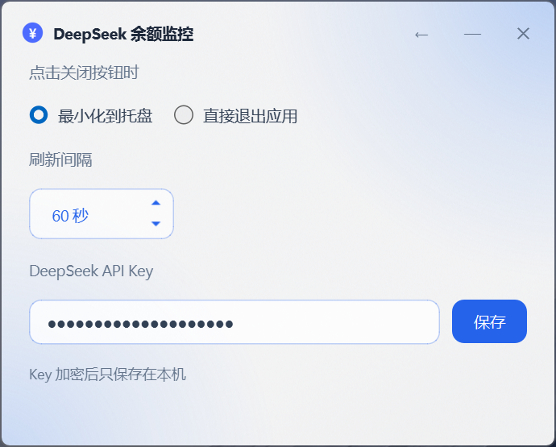

# DeepSeek 余额监控

一款常驻系统托盘的 Windows 桌面工具，用于实时查询并显示 DeepSeek API 账户余额。

界面遵循 Windows 11 原生视觉规范，采用磨砂亚克力背景、圆角窗口与系统投影，配色以蓝白为主。




## 功能特性

| 特性 | 说明 |
| --- | --- |
| 托盘常驻 | 鼠标悬停托盘图标即可查看余额明细；右键菜单首项同样显示余额，无需打开主窗口 |
| 余额展示 | 主界面以大字号显示账户总余额，并拆分显示充值余额与赠送余额 |
| 自动刷新 | 默认每 60 秒查询一次，刷新间隔可在 30 至 600 秒之间调整 |
| 窗口内设置 | 点击标题栏设置按钮，可在当前窗口内切换至设置页，无需打开独立弹窗 |
| 关闭行为可配置 | 点击关闭按钮时，可选择最小化至托盘或直接退出应用 |
| 开机自启（可选） | 安装时可勾选开机自动启动；启动后仅驻留托盘，不显示主窗口 |
| 凭据安全 | API Key 经 Windows DPAPI 加密后仅保存在本机，不传输至任何第三方服务器 |

## 系统要求

- Windows 10 / 11（64 位）
- 磨砂亚克力与原生圆角依赖 Windows 11 接口，在 Windows 10 上自动降级为纯白背景

## 安装

1. 下载 `DeepSeekBalance-Setup-1.0.0.exe`
2. 双击运行安装程序。按当前用户安装，**无需管理员权限**
3. 从开始菜单启动「DeepSeek 余额监控」
4. 首次启动将自动进入设置页，填入 API Key 后点击「保存」

API Key 可在 [DeepSeek 开放平台](https://platform.deepseek.com/api_keys) 创建。

**卸载**：通过「设置 → 应用 → 已安装的应用」卸载。卸载程序仅移除程序文件，配置文件将保留在本机，如需彻底清除请参见下文「隐私与安全」。

## 使用说明

| 操作 | 效果 |
| --- | --- |
| 鼠标悬停托盘图标 | 显示余额明细 |
| 左键单击 / 双击托盘图标 | 显示主界面 |
| 右键托盘图标 | 打开菜单，首项显示当前余额 |
| 点击标题栏设置按钮 | 切换至设置页，按钮图标同时变为返回箭头；再次点击返回主界面 |
| 点击标题栏最小化按钮 | 最小化至任务栏 |
| 点击标题栏关闭按钮 | 执行设置中选定的行为：最小化至托盘或退出应用 |
| 拖拽标题栏 | 移动窗口 |
| 双击标题栏 | 最小化至托盘 |

## 配置项

| 配置项 | 说明 |
| --- | --- |
| 点击关闭按钮时 | 选择「最小化到托盘」时，关闭按钮仅隐藏窗口，后台刷新继续进行；选择「直接退出应用」时，关闭按钮将结束进程。该设置对 `Alt` + `F4` 同样生效 |
| 刷新间隔 | 间隔越短余额越实时，对应的请求频率也越高 |
| DeepSeek API Key | 填写后点击「保存」，将立即使用该凭据执行一次余额查询 |

## 隐私与安全

本工具仅执行一项网络操作：携带用户的 API Key 请求 `https://api.deepseek.com/user/balance`。除此之外不访问任何网络地址，不收集、不上传任何数据。

API Key 通过 Windows 自带的 DPAPI（`CryptProtectData`）加密后写入以下路径：

```
%APPDATA%\DeepSeekBalance\config.json
```

加密密钥绑定当前 Windows 用户账户，因此该文件复制到其他计算机或其他用户下均无法解密。如需完全重置配置，删除上述文件即可。

## 从源码构建

### 环境要求

- Windows 10 / 11
- Python 3.10 或更高版本
- 构建安装包需额外安装 [Inno Setup 6](https://jrsoftware.org/isinfo.php)

### 安装依赖

```bash
pip install PySide6 pyinstaller pillow
```

### 运行

```bash
python main.py
```

开发过程中可用的命令行参数：

```bash
python main.py --check      # 在命令行查询一次余额并输出结果
```

```bash
python main.py --selftest   # 离线自测，校验响应解析与加解密往返
```

### 构建可执行文件

```bash
python build_icon.py
```

```bash
python -m PyInstaller --noconfirm --clean --windowed --name DeepSeekBalance --icon icon.ico main.py
```

### 构建安装包

Inno Setup 6 未内置简体中文语言文件，需先将
[ChineseSimplified.isl](https://github.com/kira-96/Inno-Setup-Chinese-Simplified-Translation)
置于项目根目录，再编译安装脚本：

```bash
"%LOCALAPPDATA%\Programs\Inno Setup 6\ISCC.exe" setup.iss
```

构建产物位于 `installer/` 目录。

## 项目结构

```
main.py            应用全部逻辑：界面、托盘、余额查询、DPAPI 加解密、亚克力窗口
build_icon.py      通过 Pillow 生成 icon.ico（仅构建期使用，不打包进应用）
setup.iss          Inno Setup 安装脚本
screenshots/       README 引用截图
LICENSE            MIT 许可证
```

## 常见问题

**提示「API 返回 401（请检查 API Key）」**
API Key 无效、已被删除，或无权查询余额。请在设置页重新填写。

**提示「网络错误」**
请检查本机网络或代理设置。部分企业网络会拦截对 `api.deepseek.com` 的请求。

**窗口未呈现磨砂效果，显示为纯白背景**
亚克力与原生圆角依赖 Windows 11 提供的接口。在 Windows 10 上将自动降级为纯白背景，功能不受影响。

**如何更换 API Key 或重置配置**
可在设置页直接更换。如需完全重置，删除 `%APPDATA%\DeepSeekBalance\config.json`。

**余额与官网显示不一致**
官网数据本身存在数分钟延迟。此外本工具按设定间隔轮询，可通过「立即刷新」强制更新。

## 已知限制

- 窗口尺寸固定，不支持拖拽调整大小
- 窗口采用无边框自绘实现，最小化时无法呈现 Windows 11 的缩小至任务栏过渡动画
- 仅支持配置单个 API Key
- 仅支持 Windows 平台

## 免责声明

本项目为第三方开源工具，与 DeepSeek 官方无任何关联。

## 许可证

[MIT](LICENSE) © 2026 Scienmicroit

本项目允许自由使用、修改与分发，包括商业用途，只需保留版权声明与许可证声明。
